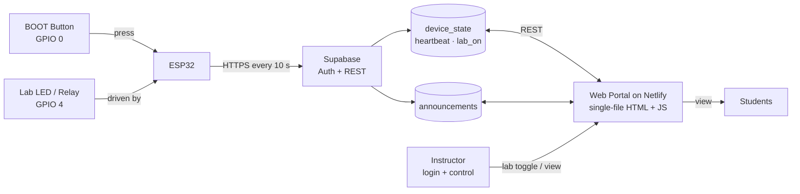
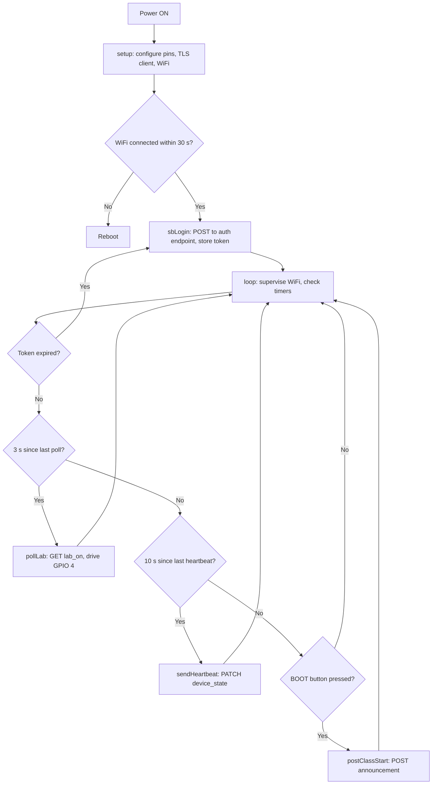

# 🎓 ESP32-Based LMS Portal
### Intelligent Learning Management System with ESP32 Controller and Cloud Backend

*A cloud-hosted student portal that an instructor controls from any browser — gated by a live ESP32 heartbeat, with one-touch class announcements and remote lab-light control from the classroom.*

Project by **M. Jayantha Siva Srinivas**
SRM University AP · Department of Skill Development

🌐 **Live Demo:** [jayantha-1009-lms.netlify.app](https://jayantha-1009-lms.netlify.app)

---

## ⚙️ How It Works

The system has three parts: an **ESP32 controller**, a **cloud backend** and a **web portal**.

An ESP32 authenticates to Supabase and sends a heartbeat **every 10 seconds**. The portal, hosted on Netlify, reads that heartbeat and gates entry — the opening screen waits for the board to report online before proceeding to login. Once inside, students and faculty can access courses, assignments, grades, attendance, lecture videos and announcements. The instructor can toggle the lab light from the portal and post a "class is starting" announcement with one press of the ESP32's BOOT button.

- 🔒 **Controller-gated portal** — the login page is only reachable while the ESP32 is online
- 🖥️ **Student dashboard** — courses, assignments, grades, attendance, lecture materials and announcements
- 💡 **Remote lab-light control** — toggle GPIO 4 from the portal, board responds within 3 seconds
- 📢 **One-touch class announcement** — pressing BOOT posts instantly to every student's dashboard
- 🟢 **Live board status** — shows ESP32 online / offline with IP, RSSI and uptime

> **By design, the portal is only accessible while the ESP32 controller is live.** When the board is off, the site shows the controller-check screen indefinitely.

---

## 🧭 System Architecture

### Data Flow

1. The ESP32 powers on, connects to Wi-Fi and logs in to Supabase with a device account.
2. Every 10 seconds the firmware PATCHes `device_state` with its IP, RSSI and uptime — this is the heartbeat.
3. Every 3 seconds the firmware GETs `lab_on` from `device_state` and drives GPIO 4 accordingly.
4. When the BOOT button is pressed, the firmware POSTs an announcement to the `announcements` table.
5. The web portal watches the heartbeat, gates the login, and reflects all state changes in real time.

### Technology Stack

| Layer | Technology |
|---|---|
| Microcontroller | ESP32 development board, Arduino IDE |
| Transport | Wi-Fi station mode, HTTPS, JSON over REST |
| Backend | Supabase: `device_state` and `announcements` tables, Auth (JWT), PostgREST API |
| Frontend | Single-file HTML, CSS and JavaScript |
| Hosting | Netlify |

---

## 🖥️ Portal Features

| Feature | Description |
|---|---|
| 🔒 Controller-check screen | Opening screen waits for the ESP32 heartbeat; pill reads *"Checking ESP32 controller…"* then *"ESP32 online, opening the portal"* |
| 🔑 Login | Username / e-mail and password with university branding |
| 🏠 Dashboard | Greets student by name; summarises enrolled courses, pending assignments, attendance % and announcements; lists three latest announcements |
| 📚 Courses | Five subjects with five units each and a syllabus link |
| 📝 Assignments | Table with course, title, due date and colour-coded status (pending / submitted / graded) |
| 📊 Grades | Weighted scheme — Internal 30, Midterm 30, End-sem 40 — with per-component columns |
| ✅ Attendance | Minimum 75 %, one check-in per hour; ring shows current percentage; recent timestamps listed |
| 🎬 Lecture Videos | Faculty-uploaded videos, images and YouTube lessons; filterable by type |
| 📢 Announcements | Newest-first list with author and timestamp; includes ESP32-originated entries |
| 💡 Lab Light Control | Toggle from the portal; ESP32 drives GPIO 4 within the 3-second poll interval |

---

## 🧩 Hardware

| Component | Pin | Function |
|---|---|---|
| Status LED (on-board) | GPIO 2 | Lit while Wi-Fi is connected; off when link is lost |
| Lab LED / relay input | GPIO 4 | Output representing the lab light; driven HIGH or LOW by the portal setting |
| Class button (BOOT) | GPIO 0 | Input with internal pull-up; a press posts the "class is starting" announcement |
| USB / 5 V supply | — | Powers the board; serial console at 115200 baud for debugging |

> For real mains lighting, connect a relay module to GPIO 4 instead of an LED.

---

## 🔁 Firmware Logic

### Firmware Configuration

| Constant | Purpose |
|---|---|
| `WIFI_SSID` / `WIFI_PASS` | Wi-Fi network name and password |
| `SB_URL` | Supabase project URL |
| `SB_ANON_KEY` | Supabase anon key (sent in `apikey` and `Authorization` headers) |
| `DEVICE_EMAIL` / `DEVICE_PASS` | Device account credentials for Supabase Auth |
| `POLL_MS` | `3000` ms — lab-light poll interval |
| `HEARTBEAT_MS` | `10000` ms — heartbeat interval |
| `TOKEN_LIFE_MS` | `2700000` ms — re-authenticate every 45 minutes |

### Key Functions

| Function | Description |
|---|---|
| `sbLogin()` | POSTs device credentials to the auth endpoint; stores the returned access token |
| `ensureToken()` | Checks token validity; re-logs in if expired, backing off 15 s after a failure |
| `sbCall()` | Common REST wrapper — adds API key and bearer token; clears token on 401; self-reboots after 15 consecutive failures |
| `pollLab()` | GETs `lab_on`; drives GPIO 4; logs only on state change |
| `sendHeartbeat()` | PATCHes `device_state` with RSSI, IP and uptime |
| `postClassStart()` | POSTs "Class is starting now — please check in." to `announcements` |

### Reliability Design

- ⏱️ **Non-blocking timing** with `millis()` — button presses are never missed
- 🔄 **Auto-reconnect** — status LED drops while Wi-Fi is down, recovers automatically
- 🔁 **Self-reboot** after 15 consecutive failed requests or a 30-second Wi-Fi failure
- 🔐 **Token refresh** every 45 minutes before the 60-minute JWT expiry
- 🔌 **Fresh TLS socket per request** with an 8-second timeout — no stale connections
- 🩺 **Diagnostic tags** `[WiFi]`, `[SB]`, `[LAB]`, `[SYS]` in Serial Monitor

---

## 🛠️ Arduino IDE Setup

| Setting | Value |
|---|---|
| Board | `ESP32 Dev Module` (or your specific variant) |
| Serial Monitor Baud | `115200` |
| Board Package | *ESP32 by Espressif Systems* (Boards Manager) |
| Built-in libraries | `WiFi`, `WiFiClientSecure`, `HTTPClient` (all part of the ESP32 core) |

> No additional libraries need to be installed — the firmware uses only ESP32 core libraries.

---

## 🗄️ Backend (Supabase)

The firmware interacts with two tables and the Supabase Auth endpoint.

| Endpoint | Method | Purpose |
|---|---|---|
| `/auth/v1/token?grant_type=password` | POST | Device login; response contains `access_token` |
| `/rest/v1/device_state?id=eq.1&select=lab_on` | GET | Read whether the lab light should be on |
| `/rest/v1/device_state?id=eq.1` | PATCH | Write heartbeat fields: `rssi`, `ip`, `uptime` |
| `/rest/v1/announcements` | POST | Insert an announcement (`author`, `text`) |

### `device_state` table (minimum schema)

| Column | Type | Description |
|---|---|---|
| `id` | integer | Row identifier — the firmware always targets `id = 1` |
| `lab_on` | boolean | Whether the lab light should be on |
| `rssi` | integer | Wi-Fi signal strength in dBm |
| `ip` | text | Board IP address |
| `uptime` | integer | Board uptime in seconds |

---

## ✅ Test Results

Testing was conducted on **13 November 2026** with the portal loaded from a browser while the ESP32 was running.

| Feature | Result |
|---|---|
| Controller-check screen (board offline) | Pill displayed red "Checking ESP32 controller…" with live counter |
| Controller-check screen (board online) | Pill turned green "ESP32 online, opening the portal" and proceeded to login |
| All nine portal sections | Loaded and rendered correctly |
| ESP32-originated announcement | Posted at 12:19:14 PM, visible on both Dashboard and Announcements page |
| Lab-light toggle | GPIO 4 responded within the 3-second poll interval |
| Attendance check-in lock | Hourly lock enforced in the interface; check-in records (11/11, 11/12, 11/18) listed |
| Automatic token refresh | Confirmed via serial log at 45-minute intervals |

**Observations**
- 🟢 The board stayed online throughout testing with heartbeats arriving every 10 seconds
- 📢 The ESP32-to-cloud-to-portal announcement path worked end-to-end in under one poll cycle
- ⚠️ Dashboard attendance tile showed 7 % while the Attendance page showed 9.5 % — a known display discrepancy to be reconciled
- 📋 Grades and Lecture Videos sections are functional but show empty states as no data has been added yet

---

## 🔒 Security and Configuration Notes

| Item | Guidance |
|---|---|
| TLS | The firmware calls `setInsecure()`: the connection is encrypted but the server certificate is **not verified**. Pin the Supabase root certificate for production. |
| Credentials in source | Keep `WIFI_PASS`, `DEVICE_PASS` and `SB_ANON_KEY` out of public repositories — use a separate `secrets.h` excluded by `.gitignore`. |
| Row-level security | Restrict the device account with Supabase RLS policies: read `lab_on`, update heartbeat fields and insert announcements only. |
| Anon key | Identifies the project and is meant to be public, but RLS policies and authenticated device access are what protect the data. |
| Admin access | Use strong passwords for all faculty and admin accounts. |

---

## ⚠️ Limitations

- 🔓 TLS certificate verification is disabled in the current firmware
- 🔑 Credentials are compiled as plain constants — not suitable for version control or shared source
- ⏳ Lab-light control has up to 3 seconds of latency due to polling
- 📍 Single device only — the design assumes one controller row (`id = 1`)
- 🔧 JSON parsing uses string matching; a full JSON library would be needed for more complex responses
- 📶 Portal features depend on Wi-Fi, internet access and Supabase free-tier limits

---

## 🚀 Future Enhancements

- [ ] Tie attendance check-in to the ESP32 so students can only check in while a class is in session
- [ ] Replace polling with Supabase Realtime (WebSocket) for instant lab-light control
- [ ] Add RFID or QR-based attendance readers to the controller
- [ ] Add environmental sensors (temperature, occupancy) and show them on a faculty dashboard
- [ ] Support multiple labs by extending `device_state` to one row per controller
- [ ] Enable over-the-air (OTA) firmware updates and store certificates securely
- [ ] Pin the Supabase root certificate in the firmware

---

## 🏁 Conclusion

The ESP32-Based LMS Portal demonstrates a complete embedded full-stack system: a robust firmware layer resilient to network faults, a Supabase backend with authenticated access and row-level security, and a polished web portal that responds to the physical state of the controller. Moving from an ESP32-hosted page to a cloud-backed design removed the LAN dependency and made the system accessible from any network, while keeping the ESP32 central to the experience through its heartbeat, lab-light control and one-touch class announcement.

---

## 👥 Author

**M. Jayantha Siva Srinivas**

**B.Tech · Electronics and Communication Engineering**
ESSCI-Certified Embedded Fullstack & IoT Analyst · SRM University (AP) · Department of Skill Development
